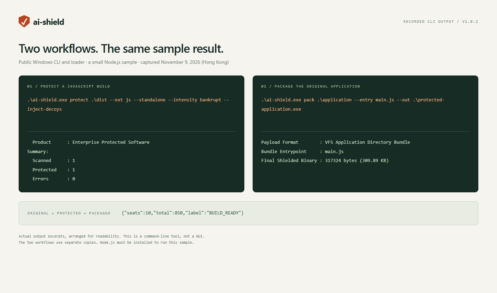
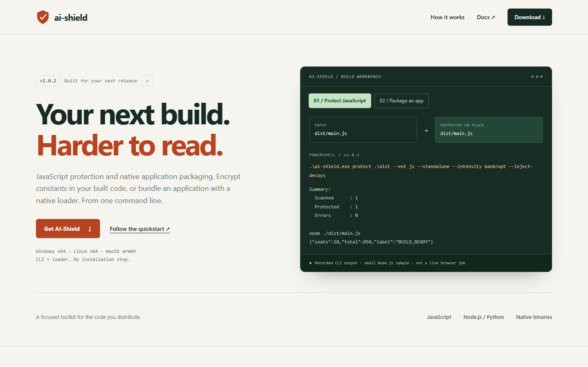

# AI-Shield

**Protect a JavaScript build. Package an application for delivery.**

AI-Shield is a command-line tool with two workflows: transform built JavaScript with obfuscation and encrypted constant pools, or package a Node.js, Python or native application and its assets into a launchable file.

[Download v1.0.2](https://github.com/manhua-man/ai-shield-web/releases/tag/v1.0.2) · [Run the quick start](QUICKSTART.md) · [Website](https://manhua-man.github.io/ai-shield-web/)

## Download

| Your platform | Release archive |
| --- | --- |
| Windows x64 | [Download ZIP](https://github.com/manhua-man/ai-shield-web/releases/download/v1.0.2/ai-shield-v1.0.2-windows-x64.zip) |
| Linux x64 | [Download tar.gz — musl](https://github.com/manhua-man/ai-shield-web/releases/download/v1.0.2/ai-shield-v1.0.2-linux-x64.tar.gz) |
| macOS Apple Silicon | [Download tar.gz — arm64](https://github.com/manhua-man/ai-shield-web/releases/download/v1.0.2/ai-shield-v1.0.2-macos-arm64.tar.gz) |

Extract the archive and keep **`ai-shield` and `ai-shield-stub` together** (`.exe` on Windows). [SHA256 checksums](https://github.com/manhua-man/ai-shield-web/releases/download/v1.0.2/SHA256SUMS.txt) are available for the release assets. Unix archives preserve executable permissions; macOS binaries are not notarized.

## Choose your workflow

| You have… | Use | You get |
| --- | --- | --- |
| A built JavaScript directory | `protect` on a copy | Transformed JavaScript to run or deploy through your existing application workflow |
| A Node.js, Python or native application with assets | `pack` | A launchable package for the matching OS/architecture; Node/Python still require their runtime |

### Protect a JavaScript build

Copy your build first: **`protect` rewrites the files in the directory you pass to it**. In this example, `dist` stays untouched and `dist-protected` becomes the output.

Windows PowerShell:

```powershell
Copy-Item -LiteralPath .\dist -Destination .\dist-protected -Recurse
.\ai-shield.exe protect .\dist-protected --ext js --standalone --intensity bankrupt --inject-decoys
```

Linux / macOS:

```sh
cp -R ./dist ./dist-protected
./ai-shield protect ./dist-protected --ext js --standalone --intensity bankrupt --inject-decoys
```

Use a fresh `dist-protected` directory, then run or serve that copy as you normally would. Check your application before deploying it. Standalone mode needs no external license token; its decryption key is included in the output.

### Package an application

This is a separate workflow. The commands below package an existing **`application`** directory with `main.js` as its entry point; they do not package the `dist-protected` directory above.

Windows PowerShell:

```powershell
.\ai-shield.exe pack .\application --entry main.js --out .\protected-application.exe
.\protected-application.exe
```

Linux / macOS:

```sh
./ai-shield pack ./application --entry main.js --out ./protected-application
./protected-application
```

Include the application's files, dependencies and assets. **Node.js and Python runtimes are not bundled** and must be available on the destination machine. For Python, choose its script with `--entry main.py`; native applications use their executable as the entry point.

**New to the tool?** The [quick start](QUICKSTART.md) creates a small Node application, runs it, then walks through each workflow with complete Windows and Unix commands.


*Actual CLI output arranged for readability. AI-Shield is a command-line tool; this is not a GUI.*

## Website preview


*The product website introduces the workflows and downloads. Its examples do not process your files in the browser.*

## What to expect

- **Windows output names:** v1.0.2 appends a missing `.exe` suffix when using a Windows PE loader. Existing `.exe` / `.EXE` suffixes stay unchanged, and `release.v1` becomes `release.v1.exe`. Unix output names are unchanged.
- **Application data:** save persistent state in the caller's working directory or an explicit stable data directory. Read bundled assets relative to the application file. Changed extraction directories are retained and reported, but are not reused on the next launch.
- **Python notices:** normal imports may create `__pycache__` / `.pyc` files and trigger that retention notice. The notice alone does not mean the application failed.
- **Protection scope:** standalone mode provides obfuscation and ciphertext integrity, not access control. Keep authoritative secrets on a trusted server; no fixed attack-resistance or performance guarantee is claimed.

## Release confidence

v1.0.2 passed **61 / 61 CI tests on each platform**. Public Windows packaging acceptance recorded **160 / 162 strict checks**: two Python stderr comparisons differed because of the documented cache-retention notice; business behavior matched, with no unresolved functional failures in the tested paths. The three public archives were downloaded and matched their checksums.

[Release notes](RELEASE-NOTES.md) contain the detailed results, historical repairs and limits, including OS trust prompts, background processes and self-updates.

## Repository and licensing

This public repository distributes the website, documentation and release binaries. The core implementation is maintained privately and is not included in GitHub source archives.

Release archives include the project license, third-party notices and build information. See [LICENSE](LICENSE) for the repository's MIT license.
